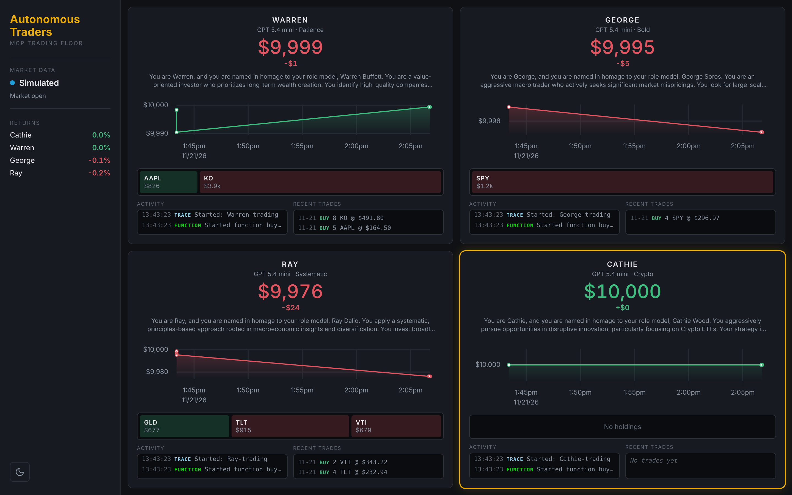

# MCP trading floor

Four AI traders (Warren, George, Ray and Cathie) each manage a $10,000 paper-trading account, each with its own
investment strategy. Every trader is an agent built with the
[OpenAI Agents SDK](https://openai.github.io/openai-agents-python/) that does all its work through **MCP servers**:
one for its account, one for market data and one for push notifications. Each trader also has a researcher sub-agent
with web search, a web page fetcher and a long-term memory. On a schedule, the traders alternate between looking for
new trades and rebalancing what they hold, and a **web dashboard** shows their portfolios, trades and activity live.

- **Models:** every model call goes through the repo's **LiteLLM proxy**, which holds the provider keys.
- **Prices:** from **Massive** with an API key, otherwise from a built-in simulator, so it runs without any market
  data subscription.
- **Paper trading only:** no real money or brokerage is involved.



*The dashboard, here with simulated prices and a few test trades. The trader in the lead is outlined in gold.*

## The three parts

```
┌───────────────────────────────┐      writes      ┌──────────────┐      reads      ┌──────────────────────┐
│ 1. Trading floor              │ ───────────────► │  accounts.db │ ◄────────────── │ 2. API (FastAPI)     │
│    backend/trading_floor.py   │                  │  (SQLite)    │                 │    backend/api.py    │
│    4 traders, every N minutes │                  └──────────────┘                 │    localhost:8000    │
│    each with its MCP servers  │                                                    └──────────┬───────────┘
└───────────────────────────────┘                                                         /api │ (JSON)
                                                                                    ┌──────────┴───────────┐
                                                                                    │ 3. Dashboard (Vite)  │
                                                                                    │    frontend/         │
                                                                                    │    localhost:5173    │
                                                                                    └──────────────────────┘
```

1. **The trading floor** runs the traders. It's the only part that changes data: trades, balances, strategies and the
   activity log, all stored in `accounts.db`.
2. **The API** serves that data as read-only JSON.
3. **The dashboard** polls the API every few seconds and draws it: a value chart, a holdings heatmap, recent trades
   and the activity log for each trader.

They run as separate processes, so the dashboard can be opened and closed without affecting the traders, and the
traders keep trading with no browser open.

## Layout

```
mcp-servers/
├── backend/                  the trading engine and the API (Python)
│   ├── trading_floor.py      entry point: creates the four traders and runs them on a schedule
│   ├── traders.py            the Trader agent and its researcher sub-agent; all models go through LiteLLM
│   ├── mcp_config.py         which MCP servers each agent gets, and how each one is started
│   ├── accounts.py           the Account model: balance, holdings, trades, profit and loss
│   ├── accounts_client.py    reads the accounts server's MCP resources (account report, strategy)
│   ├── database.py           SQLite storage (accounts.db): accounts and the activity log
│   ├── market.py             share prices from Massive, or the simulator when there's no key
│   ├── market_simulator.py   believable, repeatable simulated prices
│   ├── tracers.py            a trace processor that writes each agent step to the activity log
│   ├── reset.py              resets the four accounts to $10,000 and their starting strategies
│   └── api.py                the read-only JSON API for the dashboard (FastAPI)
├── mcp_servers/              the MCP servers this project runs itself
│   ├── accounts_server.py    tools: get_balance, get_holdings, buy_shares, sell_shares, change_strategy
│   │                         resources: accounts://accounts_server/{name}, accounts://strategy/{name}
│   ├── push_server.py        tool: push (prints the message; Pushover is ready to switch on)
│   └── market_server.py      tool: lookup_share_price (used only without a Massive key)
├── prompts/                  text you'll tune most often, kept out of the code
│   ├── templates.py          the trader's and researcher's instructions, and the trade/rebalance messages
│   └── strategies.py         each trader's starting strategy
├── frontend/                 the dashboard (TypeScript, Vite, uPlot)
│   ├── index.html            the page: sidebar (market, returns, theme) and one panel per trader
│   └── src/
│       ├── main.ts           start-up and polling (data every 6 s, logs every 2 s)
│       ├── api.ts            the API client and the types of its JSON
│       ├── state.ts          per-trader state: latest data, chart points, previous prices
│       ├── panel.ts          one trader's panel: value, profit, strategy, chart, heatmap, log, trades
│       ├── chart.ts          the portfolio value chart (uPlot), green when up and red when down
│       ├── heatmap.ts        one tile per holding, sized by value, flashing on price moves
│       ├── log.ts            the activity log
│       ├── transactions.ts   the recent trades
│       ├── theme.ts          light and dark mode, remembered in the browser
│       └── styles.css
├── mpc-notebook.ipynb        the lab notebook: MCP servers, memory, vector store, a single agent
├── accounts.db               accounts and logs (git-ignored, created on first use)
└── memory/                   the researchers' long-term memories (git-ignored)
```

## How a trader works

```
Trader agent (model via LiteLLM)
├── MCP: accounts_server   → balance, holdings, buy/sell, change strategy   → accounts.db
├── MCP: market data       → share prices (Massive, or our market_server)
├── MCP: push_server       → a short summary after each run
└── tool: Researcher       (an agent used as a tool)
    ├── MCP: Tavily        → web search (limited to tavily_search)
    ├── MCP: fetch         → read a web page
    └── MCP: memory        → a knowledge graph that persists between runs (memory/<name>.db)
```

1. **`trading_floor.py`** creates the four traders and, every `RUN_EVERY_N_MINUTES`, runs them at the same time.
   It only runs while the US market is open, unless `RUN_EVEN_WHEN_MARKET_IS_CLOSED=true`.
2. **Each run** (`traders.py`) opens the trader's and researcher's MCP servers together (an `AsyncExitStack`), reads
   the trader's **account and strategy from the accounts server's MCP resources**, and puts both in its message.
3. **The trader** researches through the researcher tool, checks prices, trades with the account tools, sends a push
   notification, and replies with a short appraisal. Runs alternate between *trade* (find new opportunities) and
   *rebalance* (review what it holds, and possibly change its strategy).
4. **Tools vs resources:** the model *calls* the tools whenever it decides to; the code *reads* the resources once at
   the start, so the model begins with its account in context.
5. **Tracing:** each run is a trace named `<Name>-trading` or `<Name>-rebalancing`. It goes to OpenAI
   (platform.openai.com/traces), and `LogTracer` also writes every step to the `logs` table, which feeds the
   dashboard's activity log.

### Models: everything through LiteLLM

`traders.py` has one OpenAI-compatible client pointed at the LiteLLM proxy, and `get_model(name)` builds every model
on it. The code never calls a provider directly: LiteLLM holds the provider keys and picks the provider from the model
name.

The models are set in `backend/trading_floor.py`:

| `USE_MANY_MODELS` | Warren | George | Ray | Cathie |
|---|---|---|---|---|
| `false` (default) | `gpt-5.4-mini` | `gpt-5.4-mini` | `gpt-5.4-mini` | `gpt-5.4-mini` |
| `true` | `gpt-5.4` | `gpt-5.4` | `gpt-5.4-mini` | `claude-haiku-5-5` |

- `model_names` are the **public model names in LiteLLM**. Each must be registered there (UI at
  `localhost:4000/ui`, **Models → Add Model**), with that provider's key. Check with
  `curl http://localhost:4000/v1/models -H "Authorization: Bearer $OPENAI_API_KEY"`.
- `short_model_names` are only **labels**: the API sends them to the dashboard, which shows them under each trader's
  name. Keep both lists in the same order.

### MCP servers

| Server | Used by | Started with | Needs |
|---|---|---|---|
| Accounts (ours) | trader | `uv run -m mcp_servers.accounts_server` | — |
| Push (ours) | trader | `uv run -m mcp_servers.push_server` | — |
| Market: Massive | trader | `uvx … mcp_massive` (pinned to v0.10.0, with `mcp<2`) | `MASSIVE_API_KEY` |
| Market: ours | trader | `uv run -m mcp_servers.market_server` | used when there's no Massive key |
| Fetch | researcher | `uvx mcp-server-fetch` | — |
| Tavily search | researcher | `npx -y tavily-mcp` (limited to `tavily_search`) | `TAVILY_API_KEY` |
| Memory (libSQL) | researcher | `npx -y mcp-memory-libsql` | — (one database per trader in `memory/`) |

Our servers run as modules (`-m`) from the project folder, because they import from `backend/`. To try one by hand in
the MCP Inspector: `npx @modelcontextprotocol/inspector uv run -m mcp_servers.accounts_server`.

## The API and the dashboard

| Endpoint | Returns |
|---|---|
| `GET /api/traders` | The four traders: name, last name, model label |
| `GET /api/traders/{name}` | Balance, strategy, portfolio value, profit, holdings (with price, average cost and unrealised profit), trades, value history |
| `GET /api/traders/{name}/logs?last_n=13` | The latest activity log rows, oldest first, each with a colour per type |
| `GET /api/market` | The price source (`massive` or `simulator`) and whether the market is open |

Interactive docs are at **localhost:8000/docs** while the API runs.

The dashboard only ever talks to its own dev server: Vite forwards `/api` to `localhost:8000` (see
`frontend/vite.config.ts`), so there's no cross-origin setup. It reads data every 6 s and logs every 2 s, adds a chart
point on each read so the line keeps moving, flashes heatmap tiles when a price changes, and outlines the current
leader in gold (nobody while the traders are tied).

## Setup

```bash
cd mcp-servers
uv sync                       # Python 3.13: openai-agents, mcp 1.x, massive, fastapi, uvicorn
cd frontend && npm install    # the dashboard: vite, typescript, uplot
```

You also need **Node.js** (`npx`) and **uv** (`uvx`) for the third-party MCP servers, and the **LiteLLM proxy**
running. Settings come from the repo-root `.env`; the code calls `load_dotenv(override=True)`, so `.env` wins over
variables set on the command line.

| Setting | Required | Purpose |
|---|---|---|
| `OPENAI_BASE_URL` | yes | The LiteLLM proxy, e.g. `http://localhost:4000` |
| `OPENAI_API_KEY` | yes | A LiteLLM key (not a real OpenAI key) |
| `OPENAI_TRACING_API_KEY` | yes | A real OpenAI key, used only to upload traces |
| `TAVILY_API_KEY` | yes | The researcher's web search |
| `MASSIVE_API_KEY` | no | Real market data; without it, prices are simulated |
| `USE_MANY_MODELS` | no | `true` gives each trader its own model (see above) |
| `RUN_EVERY_N_MINUTES` | no | How often the traders run (default 60) |
| `RUN_EVEN_WHEN_MARKET_IS_CLOSED` | no | `true` to run outside US market hours (for testing) |

## Running

Start each part in its own terminal, from `mcp-servers/`:

```bash
uv run -m backend.reset                         # once: four accounts with $10,000 and their strategies

uv run -m backend.trading_floor                 # terminal 1: the traders (Ctrl+C to stop)
uv run uvicorn backend.api:app --port 8000      # terminal 2: the API
cd frontend && npm run dev                      # terminal 3: the dashboard → http://localhost:5173
```

`backend.reset` wipes all trades and history, so run it only for a fresh start. To build the dashboard as static files
instead, run `npm run build` in `frontend/`; the output goes to `frontend/dist/`.

## Testing step by step

1. **Models:** each name in `model_names` answers through the proxy.
   ```bash
   uv run python -c "
   import asyncio
   from agents import Agent, Runner
   from backend.traders import get_model
   from backend.trading_floor import model_names
   async def main():
       for name in model_names:
           try:
               r = await Runner.run(Agent(name='ping', instructions='Reply with OK.', model=get_model(name)), 'ping')
               print('ok ', name, r.final_output)
           except Exception as e:
               print('ERR', name, type(e).__name__, str(e)[:100])
   asyncio.run(main())"
   ```
2. **One trader, one run** (a few minutes; the first run downloads the third-party servers):
   ```bash
   uv run python -c "
   import asyncio
   from agents import add_trace_processor
   from backend.tracers import LogTracer
   from backend.traders import Trader
   add_trace_processor(LogTracer())
   asyncio.run(Trader('Warren', 'Patience', 'gpt-5.4-mini').run())"
   ```
3. **What it did:** start the API and the dashboard and look at Warren's panel, or check the trace at
   platform.openai.com/traces and each model call's cost in the LiteLLM UI.
4. **The whole floor:** set `RUN_EVEN_WHEN_MARKET_IS_CLOSED=true` and `RUN_EVERY_N_MINUTES=10` in `.env`, then
   `uv run -m backend.trading_floor`. Remove both afterwards.

## What stays out of git

Git-ignored in the repo's root `.gitignore`: `.env` (all keys), `accounts.db` and every `*.db`, `memory/` (the agents'
memories, which can contain personal information), `frontend/node_modules/`, `frontend/dist/`, `.venv/` and
`__pycache__/`. Settings to share go in a `.env.example` with placeholder values.

## Troubleshooting

| Symptom | Likely cause |
|---|---|
| `Error running trader <Name>: …` | `Trader.run` catches every error so one trader can't stop the others; the message says what failed (often a missing key or a model name not registered in LiteLLM) |
| `Tracing client error 401` | Traces were sent with the LiteLLM key: check `OPENAI_TRACING_API_KEY` |
| `ClosedResourceError` | An MCP server was closed while the agent still needed it: everything that uses a server must run inside its `async with` |
| A trade reported as an error although it happened | A tool's return annotation doesn't match what it returns (FastMCP checks results against it) |
| Dashboard panels empty, "Connecting" in the sidebar | The API isn't running on port 8000, or the trading floor hasn't created the accounts yet (`uv run -m backend.reset`) |
| `Storage folder … is already accessed` | Two processes opened the same local vector store (notebook): restart the kernel |
| Garbled or dropped MCP messages | Something printed to stdout inside a stdio MCP server; print to stderr instead |
