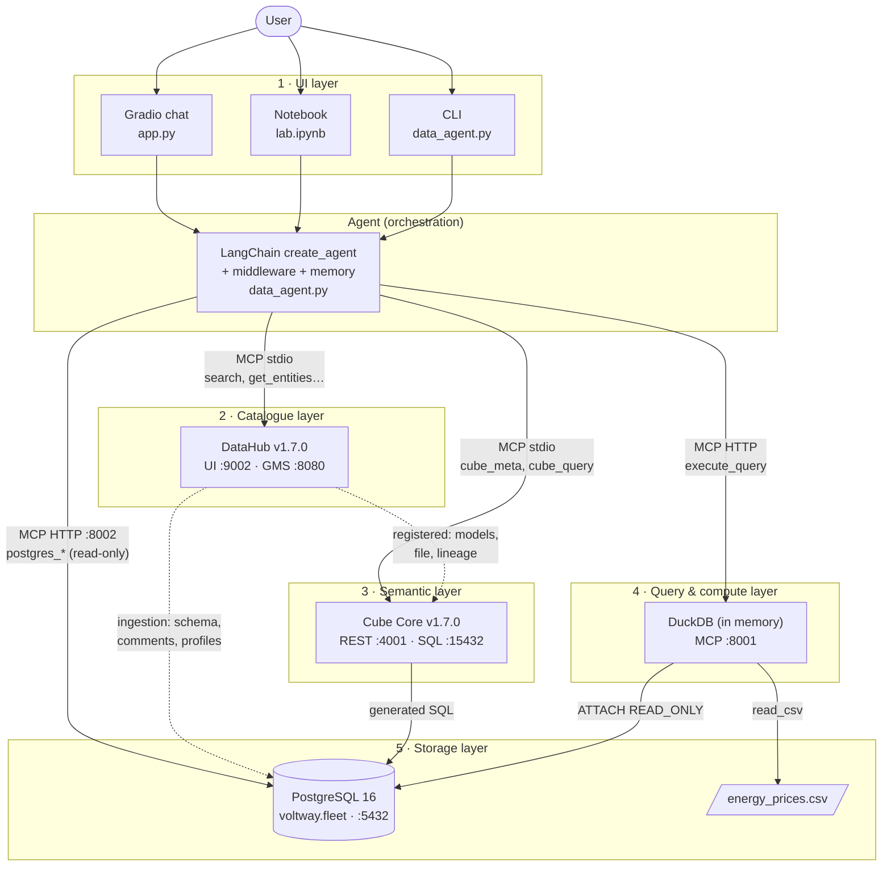
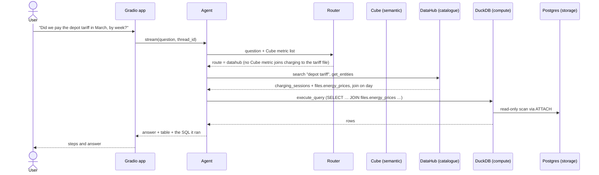

# Architecture: Voltway Semantic Layer Agent

A question in plain English goes down through five layers and comes back up as an answer with the SQL or
metric that produced it. Each layer has one job, its own technology, and talks to the others through a narrow,
read-only interface. The agent connects them: it reaches every lower layer through an MCP server.

## Layers at a glance

| # | Layer | Technology | Job | Agent reaches it through |
|---|-------|------------|-----|--------------------------|
| 1 | UI | Gradio 6, Jupyter, CLI | Take the question, show each step and the answer | Calls the agent directly (`DataAgent.stream` / `ask`) |
| – | Agent | LangChain `create_agent` on LangGraph | Plan, choose the right layer, write SQL, check, answer | – |
| 2 | Catalogue | DataHub | Say what data exists, what it means, who owns it and what is sensitive | `mcp-server-datahub` (stdio, read-only tools) |
| 3 | Semantic | Cube Core | Define each business metric once and compute it consistently | `mcp_servers/cube_mcp_server.py` (stdio) |
| 4 | Query & compute | DuckDB | Run ad-hoc SQL across the database and files in one query | `mcp-server-motherduck` in Docker (HTTP) |
| 5 | Storage | PostgreSQL + CSV | Hold the data | `mcp_servers/postgres_mcp_server.py` in Docker (HTTP), for schema details |

---

## 1 · UI layer

**Job:** the only layer people touch. It sends a question to the agent and streams back what the agent does.

| Component | File | Notes |
|-----------|------|-------|
| Chat app | `app.py` | Every tool call appears as a collapsible step (SQL, Cube query, catalogue lookup) with its result; errors are labelled "retrying". One conversation per browser session (`thread_id`), so follow-up questions work. Runs share one queue (`concurrency_id="agent"`). |
| Notebook | `lab.ipynb` | Guided walkthrough: health check, tools per server, five example questions (metric, follow-up, federated SQL, catalogue, guardrail). |
| CLI | `data_agent.py "question"` | One question, prints the answer. |

**Interface to the agent:** `DataAgent.stream(question, thread_id)` yields `tool_call`, `tool_result` and
`answer` events; `DataAgent.ask()` returns only the final answer.

## Agent (orchestration)

Not one of the five data layers, but what connects them. `data_agent.py`:

- **Tools:** one long-lived session per MCP server (`McpSessions`), so the stdio servers aren't restarted on every
  call. The tools of all four servers are given to one `create_agent`.
- **Model:** `AGENT_MODEL` (default `gpt-5.4`), called through the LiteLLM gateway configured in the repo-root `.env`.
- **Routing middleware (`middleware/routing.py`, `RouteToLayer`):** before the first model call, a small router model
  (`ROUTER_MODEL`) classifies the question as `cube`, `datahub` or `direct`, using the list of Cube metrics. For
  `cube` and `datahub`, the first model call is offered only that layer's tools and must call one; later calls get
  every tool, so fallbacks still work. The decision is kept in the agent state (`route`, `route_reason`), streamed to
  the UI and recorded in the trace.
- **Workflow (system prompt):**
  1. A **business metric** goes to the **semantic layer** first, because its definitions are the agreed ones.
  2. Otherwise the agent looks the data up in the **catalogue**: meaning, join keys, glossary terms and `pii` tags.
  3. It checks the exact columns, then writes **one read-only DuckDB query** in the **query & compute layer**.
  4. It reads any error, fixes the query and retries (at most 3 times), then sanity-checks the result.
  5. It answers with units and the period covered, plus "How I got this": the query it ran.
- **Middleware:**
  - `RouteToLayer` picks the starting layer (above).
  - `ReadOnlySqlGuard` (`middleware/sql_guard.py`) parses SQL with sqlglot and allows one statement only, of type SELECT/WITH/DESCRIBE/SHOW/SUMMARIZE.
  - `ToolErrorsToModel` (`middleware/tool_errors.py`) returns failures to the model instead of crashing the run.
  - `model_retry`, `model_fallback` and `tool_retry` (`middleware/retries.py`) retry temporary model and MCP failures
    with backoff, and switch to `FALLBACK_MODEL` if the agent model keeps failing.
  - `email_masking` (`middleware/pii.py`, LangChain's `PIIMiddleware`) redacts emails in tool results and answers.
  - `ModelCallLimitMiddleware(25)` and `ToolCallLimitMiddleware(40)` cap each question.
- **Memory:** a LangGraph checkpointer saves each `thread_id`'s conversation for follow-ups. By default it's
  `AsyncPostgresSaver` on the `agent_state` database (owned by `agent_app`, separate from the read-only fleet data),
  so conversations survive restarts. `CHECKPOINTER=memory` uses `InMemorySaver` instead (evals, notebook, tests).

## 2 · Catalogue layer: DataHub

**Job:** the map of the data, so the agent (and people) find the right table and understand it before querying.

| What | Where it comes from |
|------|---------------------|
| Tables, columns, types, comments, row counts, column profiles (min/max/nulls/distinct, **no sample values**) | `catalog/postgres_recipe.yml`, ingested as `catalog_reader` |
| Business glossary: Energy Efficiency, Charging Cost per kWh, Public Charging Share, Fleet Size, Downtime, Depot Tariff, Personal Data | `catalog/glossary.yml` (stable ids → stable URNs) |
| Per table: grain, keys, joins, how to query it (DuckDB / Postgres / Cube); column descriptions; `fact`, `dimension`, `pii` tags; glossary terms; owner | `catalog/enrich_catalog.py` |
| `files.energy_prices` (the CSV, platform `duckdb`) | `enrich_catalog.py` |
| Each Cube cube as a dataset (platform `cube`) listing its measures and dimensions, with **lineage** to its Postgres table | `enrich_catalog.py`, read straight from `cube/model/*.yml` |

**Interface:** `uvx mcp-server-datahub@0.8.0` over stdio, with only the read tools enabled (`search`,
`get_entities`, `list_schema_fields`, `get_lineage`, …).
**Runs:** DataHub's official v1.7.0 quickstart services (GMS, frontend, actions, MySQL, OpenSearch, Kafka, and a
one-off system-update job), included in the project's compose file from `docker/datahub/docker-compose.quickstart.yml`.
It needs about 8 GB of RAM for Docker.

## 3 · Semantic layer: Cube Core

**Job:** one definition per business metric, so "fleet size" or "kWh per 100 km" means the same thing in every
answer, whichever tables they need.

| Cube | Key metrics | Joins |
|------|-------------|-------|
| `vehicles` | `count`, `active_count` (fleet size), `total_purchase_value_eur`, `avg_battery_kwh` | → depots |
| `trips` | `count`, `total_distance_km`, `total_energy_kwh`, `avg_trip_km`, `energy_per_100km` | → vehicles, drivers |
| `charging_sessions` | `count`, `total_energy_kwh`, `total_cost_eur`, `cost_per_kwh`, `public_charging_share` | → vehicles |
| `maintenance_events` | `count`, `total_cost_eur`, `total_downtime_hours` | → vehicles |
| `drivers` | `count` (no email: personal data stays out of the semantic layer) | → depots |
| `depots` | `count` | – |

Ratios are defined as ratios of sums (`100 × SUM(energy) / SUM(distance)`), never averages of per-row ratios.

**Interface:** `mcp_servers/cube_mcp_server.py` (stdio):
- `cube_meta` lists the metrics and dimensions;
- `cube_query` runs a REST `/load` query, waits while Cube answers "Continue wait", and caps the result at 500 rows;
- `cube_sql` shows the SQL Cube generates.

Requests carry a JWT signed with `CUBEJS_API_SECRET`.
**Runs:** `cubejs/cube:v1.7.0` in dev mode (Playground on :4001, Postgres-compatible SQL API on :15432). Dev mode
skips JWT checks, so it's for local use only.

## 4 · Query & compute layer: DuckDB

**Job:** answer the questions the semantic layer doesn't cover: any join, any filter, and data that isn't in Postgres.

- An **in-memory** DuckDB that, at start-up (`docker/duckdb/start.sh`), attaches:
  - Postgres **READ_ONLY** as the `voltway` catalog, so the tables are `voltway.fleet.<table>`;
  - `energy_prices.csv` as the view `files.energy_prices`.
- One query can therefore join operational data with the file, e.g. depot charging cost vs. the daily tariff.
- Heavy aggregation runs in DuckDB's columnar engine. The Postgres extension pushes filters down to the source.

**Interface:** `mcp-server-motherduck==1.1.1` over streamable HTTP (:8001): `execute_query`, `list_tables`,
`list_columns`, `list_databases`, with at most 500 rows and a 60 s timeout per query.
**Runs:** `docker/duckdb/Dockerfile` (Python 3.12 + the Postgres extension downloaded at build time).

## 5 · Storage layer: PostgreSQL and files

**Job:** the system of record.

| Object | Grain | Rows |
|--------|-------|------|
| `fleet.depots` | depot | 4 |
| `fleet.vehicles` | vehicle | 40 |
| `fleet.drivers` | driver (personal data) | 50 |
| `fleet.trips` | trip | 6,000 |
| `fleet.charging_sessions` | charging session | 3,000 |
| `fleet.maintenance_events` | maintenance event | 140 |
| `energy_prices.csv` | day | 304 |

- **Schema with comments:** `docker/postgres/init/01_schema.sql`. The comments become the catalogue's first descriptions.
- **Dummy data:** `02_seed.sql`, generated from a fixed seed so every fresh database is identical.
- **Roles:** `03_roles.sh`:

| Role | Access | Used by |
|------|--------|---------|
| `admin` | owner | setup only |
| `analyst` | read-only, 30 s statement timeout | agent, MCP servers, Cube, DuckDB |
| `catalog_reader` | SELECT plus temporary tables (for profiling) | DataHub ingestion |

**Interface:** `mcp_servers/postgres_mcp_server.py` over streamable HTTP (:8002). Its tools are
`postgres_list_tables`, `postgres_describe_table`, `postgres_execute_sql` and `postgres_explain_query`.
Every call runs in a READ ONLY transaction with a timeout and returns at most 500 rows. The agent uses it for
exact types and constraints; it answers questions through DuckDB.

---

## Request flow

## Cross-cutting concerns

| Concern | How it's handled |
|---------|------------------|
| **Read-only by design** | Five independent locks: (1) the SQL guard middleware; (2) the read-only `analyst` role; (3) DuckDB's `ATTACH … READ_ONLY`; (4) READ ONLY transactions in the Postgres MCP server; (5) DataHub MCP mutation tools left off |
| **Personal data** | `pii` tags and the Personal Data term in the catalogue; no sample values ingested; email not in the semantic layer; the prompt says to aggregate and never show emails; and `PIIMiddleware` enforces it: emails are redacted before the model reads tool results and before answers are saved or shown |
| **Resilience** | Temporary model and MCP failures are retried with backoff; an optional fallback model; tool errors go back to the model; a clear error if the conversation database is missing |
| **Consistent metrics** | Defined once in Cube, described in the glossary, and the agent routes metric questions to Cube first |
| **Traceability** | Every answer ends with the query it ran; the UI shows the route and every tool call; the catalogue holds lineage from Cube to Postgres |
| **Tracing** | LangSmith, turned on by `LANGSMITH_*` variables: one trace per question with the router, model and tool calls, tagged with the models and thread |
| **Evaluation** | `evals/`: 18 questions with computed answers; rule-based scores for route, first layer, facts, forbidden content and tool errors, plus an optional LLM judge; runs as a LangSmith experiment or offline |
| **Cost and runaway control** | Step limits per question; row caps (500) and timeouts at every query interface |
| **Secrets** | Passwords and the Cube secret are in the project `.env`; model keys are in the repo-root `.env`; both are git-ignored |

## Deployment and ports

| Service | Runs as | Host port |
|---------|---------|-----------|
| PostgreSQL | `docker/docker-compose.yml` → `postgres` | 5432 |
| DuckDB MCP | compose → `duckdb-mcp` | 8001 |
| Postgres MCP | compose → `postgres-mcp` | 8002 |
| Cube | compose → `cube` | 4001 (REST, Playground), 15432 (SQL API) |
| DataHub | compose → `frontend-quickstart`, `datahub-gms-quickstart`, `datahub-actions-quickstart`, `system-update-quickstart`, `mysql`, `opensearch`, `kafka-broker` (included file, `quickstart` profile) | 9002 (UI), 8080 (GMS, `DATAHUB_MAPPED_GMS_PORT`), 4319, 3306, 9200, 9092 |
| DataHub MCP, Cube MCP | started by the agent (stdio) | – |
| LiteLLM gateway (repo root) | `docker-compose.quickstart.yml` | 4000 |
| Gradio app | `uv run python app.py` | 7860 |

Every service, DataHub included, is in one Compose project (`voltway`, `docker/docker-compose.yml`) on one network
(`datahub_network`), so `docker compose … ps` lists them all and any service can reach Postgres as `postgres:5432`.
DataHub ingestion runs from the host and reads Postgres through its host port. `scripts/setup.sh` brings
everything up, and `scripts/check_stack.py` checks each service.

## Design decisions

- **Semantic layer before SQL:** metric questions get the agreed definition, and generated SQL is kept for what the
  model doesn't cover.
- **DuckDB as the SQL engine instead of querying Postgres directly:** one dialect, file and database data joined
  in a single query, columnar aggregation, and the read-only `ATTACH` as an extra lock.
- **Our own Cube and Postgres MCP servers:**
  - Cube Core has no official MCP server.
  - The popular `crystaldba/postgres-mcp` currently can't be installed: its latest release pins a dependency version
    that's no longer on PyPI.
  - Both servers are about 100 lines, read-only, and their tool names don't clash.
- **The catalogue describes the semantic layer too:** Cube models appear in DataHub with lineage, so searching the
  catalogue also finds the governed metrics.

## Limitations and next steps

- Local-only setup: Cube runs in dev mode, DataHub has metadata-service auth off, and the passwords are defaults.
- The app has no login: keep it on your own machine. A shared deployment needs authentication (e.g. single sign-on)
  and the user's identity on each run.
- Saved conversations are never deleted; add a retention job (e.g. delete threads older than 90 days).
- If an MCP server crashes, its session stays broken until the app restarts (tool_retry only helps with brief drops),
  and the app answers one question at a time.
- The SQL guard checks the statement type, not the cost. Large joins rely on the row caps and timeouts.
- The evaluation set is small (18 questions) and its expected numbers are tied to the seed data. Grow it from real
  questions (LangSmith traces with bad feedback are a good source) and run it in CI before changing models or prompts.
- The router adds one small model call per question. Questions that clearly need both layers still start in one.
